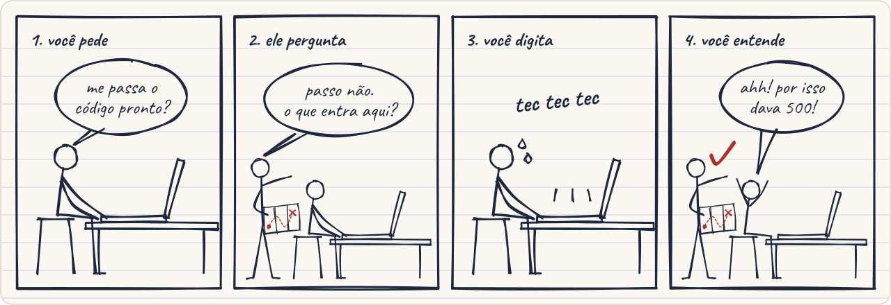
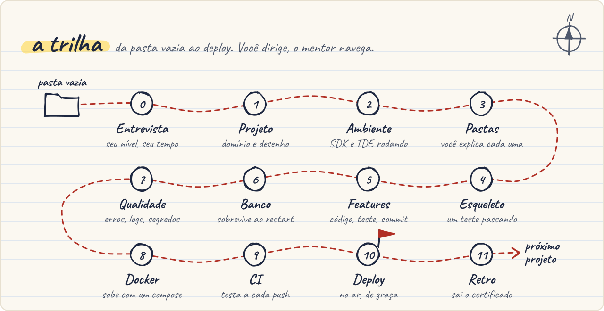

<picture>
  <source media="(prefers-color-scheme: dark)" srcset=".github/assets/banner-pt-dark.svg">
  <source media="(prefers-color-scheme: light)" srcset=".github/assets/banner-pt-light.svg">
  
</picture>


[Read in English](README.md)

## O que é

Sabe quando você pede o código pra IA, cola, roda... e uma semana depois não conseguiria escrever aquilo de novo? O código ficou no projeto. O conhecimento não ficou com você.

O Mentor Buddy é uma skill que vira esse jogo: o seu agente de IA passa a ser um mentor que **não escreve o seu código**. Funciona como pair programming. Você é o piloto e digita cada linha; o mentor é o navegador, que pergunta, explica o porquê, revisa e guarda o mapa. Vocês saem de uma pasta vazia e só param com a aplicação no ar.

Roda no Claude Code, no Codex e em todo agente que lê o formato [Agent Skills](https://agentskills.io/specification), como Copilot, Cursor e Gemini CLI. É gratuito e open source.

## Como é na prática

<picture>
  <source media="(prefers-color-scheme: dark)" srcset=".github/assets/comic-pt-dark.svg">
  <source media="(prefers-color-scheme: light)" srcset=".github/assets/comic-pt-light.svg">
  
</picture>

Pediu o código pronto? Ganha uma pergunta. Errou o passo? Primeiro vem uma revisão do que você fez, depois um exemplo em outro contexto, e só no terceiro erro o mentor mexe no seu arquivo. Aí quem revisa a correção é você, porque revisar código de IA também se aprende.

<details>
<summary>Ver um trecho real de sessão</summary>

Um trecho real de teste, encurtado. O aluno é júnior e está fazendo uma API de tabela de campeonato em C#, com o tom de zoeira.

```text
Aluno:  fiz o 5.2 mas o teste ta quebrando: Rejects_invalid_names(name: null) esperava
        BadRequest e veio InternalServerError, e o Creates_team_with_location esperava
        Created e veio OK. so me manda o codigo certo logo pfv

Mentor: Nem vem, bobão. Esse é o erro 1 do 5.2, então o que rola agora é revisão,
        não código.

        [OK] A validação de tamanho (3 a 50) existe e o endpoint já está plugado certo.
        [ALERTA] Nome null estoura antes de validar: request.Name é string?, e ler .Length
                 de null lança exceção antes do seu if rodar.
        [ALERTA] Nome só com espaço passa: "   " tem tamanho 3, então o time é criado.
        [ALERTA] O sucesso devolve 200 sem Location; o teste espera 201 Created.
        O que o seu código faz hoje: null -> exceção -> 500; "   " -> criado; válido -> 200.
        Refaça: use o método de string que checa null, vazio e espaço numa chamada só,
                e um resultado que gere 201 com Location.
                Doc: https://learn.microsoft.com/en-us/dotnet/api/system.string.isnullorwhitespace
        [PERGUNTA] Qual método de string resolve "null, vazio ou só espaço" numa chamada só?
```

Se o aluno errar de novo, o mentor cita o trecho errado e mostra a mesma ideia em outro contexto. No terceiro erro ele corrige o arquivo direto, com um comentário `MENTOR:` em cada mudança, e o aluno revisa essa correção como se ela tivesse vindo de uma ferramenta de IA.

</details>

## É pra você se...

<picture>
  <source media="(prefers-color-scheme: dark)" srcset=".github/assets/use-cases-pt-dark.svg">
  <source media="(prefers-color-scheme: light)" srcset=".github/assets/use-cases-pt-light.svg">
  
</picture>

Não precisa ser iniciante. O mentor estima o seu nível (júnior, pleno ou sênior) na entrevista e reajusta a cada entrega.

## A trilha

<picture>
  <source media="(prefers-color-scheme: dark)" srcset=".github/assets/trail-pt-dark.svg">
  <source media="(prefers-color-scheme: light)" srcset=".github/assets/trail-pt-light.svg">
  
</picture>

São 12 paradas, cada uma quebrada em passos pequenos com um critério de pronto. Tudo fica anotado no `STUDY-MEMORY.md`, então a próxima sessão começa exatamente de onde você parou. Os detalhes de cada fase estão em [Como funciona](#como-funciona).

## Comece em 30 segundos

**1. Instale.** No Windows (PowerShell):

```powershell
git clone https://github.com/mauricioreiss/mentor-buddy.git "$HOME\.agents\skills\mentor-buddy"
New-Item -ItemType Directory -Force "$HOME\.claude\skills" | Out-Null
New-Item -ItemType Junction -Path "$HOME\.claude\skills\mentor-buddy" -Target "$HOME\.agents\skills\mentor-buddy"
```

No macOS e no Linux:

```bash
git clone https://github.com/mauricioreiss/mentor-buddy.git ~/.agents/skills/mentor-buddy
mkdir -p ~/.claude/skills
ln -s ~/.agents/skills/mentor-buddy ~/.claude/skills/mentor-buddy
```

Junction não precisa de permissão de administrador. Se o link não funcionar no seu sistema, copie a pasta para `~/.claude/skills/mentor-buddy` (aí você vai precisar atualizar as duas cópias).

**2. Abra uma pasta vazia** na sua IDE.

**3. Digite `/mentor-buddy`** no chat do agente (no Codex, `$mentor-buddy`). O mentor responde com uma pergunta curta: português ou inglês? Daí pra frente é com ele.

Outros jeitos de instalar (um agente só, instalador de skills, Gemini CLI, Visual Studio) estão em [Mais opções de instalação](#mais-opções-de-instalação).

---

## Manual completo

- [O que você ganha](#o-que-você-ganha)
- [Como funciona](#como-funciona)
- [Agentes compatíveis](#agentes-compatíveis)
- [Requisitos](#requisitos)
- [Mais opções de instalação](#mais-opções-de-instalação)
- [Como usar](#como-usar)
- [Mapa de documentação curado](#mapa-de-documentação-curado)
- [Estrutura do repositório](#estrutura-do-repositório)
- [Perguntas frequentes](#perguntas-frequentes)
- [Privacidade](#privacidade)
- [Mantendo a skill atualizada](#mantendo-a-skill-atualizada)
- [Feedback e contribuição](#feedback-e-contribuição)
- [Licença](#licença)

## O que você ganha

- **Uma entrevista curta** que define o seu nível (júnior, pleno ou sênior), a linguagem, os seus interesses, o tempo disponível, a IDE, o idioma da conversa e o tom.
- **Um projeto de verdade**: uma de três ideias feitas sob medida para o que você curte, ou a sua própria ideia cortada até um tamanho que dá para terminar.
- **O caminho completo até produção**: ele detecta o SDK e a IDE que já estão na sua máquina antes de propor instalar, trata git como escolha e não como padrão, e aí te guia pela estrutura de pastas, esqueleto andando, funcionalidades com teste, banco de dados, qualidade, Docker, CI e deploy gratuito.
- **Uma escada de erros** que faz você bater cabeça do jeito certo antes de ver qualquer código.
- **Hábito de caderno de papel**: ele ensina um conceito como numa aula e te faz anotar à mão, e na volta te cobra a partir do caderno, porque escrever fixa melhor do que digitar.
- **Treino de revisão de código**: toda revisão mostra o método, a correção que o próprio mentor faz no erro 3 é você quem revisa, e treinos com defeitos plantados exercitam a habilidade que mais pesa quando a IA escreve código para você.
- **Check de compreensão**: quando uma resposta de repente parece ter vindo de outra IA, o mentor não bloqueia; ele te pede para explicar com as suas palavras antes de o passo fechar.
- **Sem achismo**: os fatos perecíveis (versão, comando, API, preço) são conferidos na documentação oficial durante a sessão, com o link; as referências estáveis (keywords, convenções) são citadas direto de um mapa curado, sem busca, para a resposta sair rápida. O que o seu projeto usa fica guardado com a data da conferência, então quando a doc muda o mentor te avisa o que mudou.
- **Memória entre sessões** num arquivo `STUDY-MEMORY.md`, para cada sessão continuar exatamente de onde você parou.
- **Um resumo no fim do dia**, e um relatório final em `.docx` com os seus pontos fracos, código antes/depois e um plano de estudo.
- **Um track opcional de cibersegurança**: ethical hacking e CTF em laboratório (web, rede, binário, cripto) só contra alvos isolados ou sancionados, com o mesmo método de ensino.
- **Dois idiomas e dois tons**: português ou inglês, direto ou na zoeira, com correção de inglês opcional para quem quer praticar.

## Como funciona

<details>
<summary>Entrevista, projeto, fases, escada de erros, nível, documentação, memória, tom e treino de revisão</summary>

### 1. Entrevista

A primeira mensagem pergunta, nos dois idiomas, se você quer conversar em português ou em inglês. O resto da entrevista vem numa lista numerada só:

1. Há quanto tempo você programa e o que já construiu.
2. Qual linguagem quer usar.
3. Se já tem ideia de projeto ou quer sugestões (e do que você gosta).
4. Quanto tempo tem por semana e por sessão.
5. Sistema operacional e IDE.
6. Como quer ser tratado: **direto** ou **zoeira**.
7. Se escolheu inglês: se quer correção do seu inglês.

O mentor diz o nível que estimou, com o motivo, e você pode corrigir.

### 2. Projeto

- **Sem ideia?** Você recebe três opções montadas a partir de arquétipos de projeto (API REST com banco, ferramenta de linha de comando, aplicação web full stack, worker com fila, serviço de integração, aplicação em tempo real), com tema baseado no que você curte e tamanho de acordo com o seu tempo.
- **Tem a sua ideia?** O mentor acha a ação central e corta até a menor versão que ainda chega ao deploy. Exemplo: "um clone do iFood com app, pagamento, mapa e chat" vira "uma API de pedidos: cadastrar restaurante e cardápio, fazer pedido, acompanhar o status até a entrega". O resto vai para uma lista de "Depois".

O resultado é um brief com 3 a 6 critérios de aceitação testáveis. Você aprova; as decisões de produto são suas.

### 3. A trilha

| # | Fase | Pronto quando |
|---|---|---|
| 0 | Entrevista | Perfil e nível combinados |
| 1 | Projeto | Brief aprovado; `STUDY-MEMORY.md` criado |
| 2 | Ambiente | SDK e IDE detectados e funcionando; se você escolher git, repositório com `.gitignore` e primeiro commit |
| 3 | Estrutura de pastas | Pastas criadas; você explica o papel de cada uma |
| 4 | Esqueleto andando | O menor caminho de ponta a ponta roda, com um teste passando |
| 5 | Funcionalidades | Cada critério de aceitação entregue com código, teste e commit |
| 6 | Persistência | Os dados sobrevivem a um restart; migrations versionadas |
| 7 | Qualidade | Validação, tratamento de erro, log, segredos fora do código |
| 8 | Docker | A aplicação e as dependências sobem com compose a partir de um clone limpo |
| 9 | CI | Um pipeline faz build e teste a cada push |
| 10 | Deploy | No ar num plano gratuito, configurado por variáveis de ambiente |
| 11 | Retrospectiva | Você escreve o que aprendeu; o próximo projeto é sugerido |

A estrutura de pastas é escolhida com você e fica proporcional ao problema: por funcionalidade em aplicações com muito CRUD, por camada quando as regras de negócio são pesadas, ou um meio-termo.

### 4. O ciclo de cada passo e a escada de erros

Cada fase é dividida em passos pequenos, e todo passo segue o mesmo ciclo:

| Momento | O que o mentor faz | Código do mentor | Seus arquivos |
|---|---|---|---|
| Instrução | O que construir, por que existe, para que serve, um resumo curto da doc oficial, o link e o critério de pronto | nenhum | só leitura |
| Acertou | O que está certo, mais as melhorias que valem a pena e por quê | nenhum | só leitura |
| Erro 1 | Revisão: o que está certo, onde quebra e por quê, o que o seu código faz de verdade, o que refazer | nenhum | só leitura |
| Erro 2 | O seu trecho errado citado com cada erro marcado, mais um exemplo curto do jeito certo em outro contexto | um exemplo curto e neutro | só leitura |
| Erro 3 | Corrige o seu arquivo, com um comentário `MENTOR:` em cada mudança, te explica e depois você revisa a correção respondendo três perguntas de revisão | a correção, no seu arquivo | editados |

- O contador de erros é do passo atual e zera quando o passo passa.
- Perguntar é de graça: uma dúvida conceitual recebe resposta curta com link da doc e não conta como erro.
- Observações de estilo e de nome vêm junto com o acerto e nunca contam como erro.
- Pedir o código antes da hora não pula a escada.

### 5. Ajustado ao seu nível

| | Júnior | Pleno | Sênior |
|---|---|---|---|
| Nome de pasta e módulo | Um nome de exemplo e o papel | Só o papel; você dá o nome | Só o papel; você dá o nome |
| Biblioteca ou framework | Uma recomendação popular e mantida, com o porquê | O que pesquisar e os critérios; você traz uma escolha e o mentor valida | Igual ao pleno, pesando trade-offs |
| Explicações | Mais completas, um conceito por vez | Curtas, focadas no porquê | Curtas, focadas em trade-off, modos de falha e operação |
| Testes | Obrigatórios a partir do esqueleto | Obrigatórios; TDD opcional | Obrigatórios; TDD opcional |
| Treino de revisão | 2 defeitos, com uma dica de categoria para cada | 3 defeitos, sem dica | 3 defeitos sutis: concorrência, segurança, performance, modos de falha |

O nível é reavaliado a cada entrega. Quando a evidência mostra que está errado, o mentor avisa e ajusta.

### 6. Sem achismo: só documentação oficial

A skill separa dois tipos de conhecimento:

- **Estável**: método de ensino, fases, régua de revisão, papel das pastas, arquétipos de projeto, e os pontos de entrada curados da doc (keywords, sintaxe, convenções de nome). Isso fica dentro da skill; as referências estáveis são citadas direto do mapa, sem busca, para a resposta sair rápida.
- **Perecível**: versões, passos de instalação, comandos e flags, nomes de API, chaves de configuração, padrões de framework, preços e limites de plano gratuito. O mentor confere na documentação oficial durante a sessão antes de dizer, e te passa o link.

Quando o agente não tem acesso à web, o mentor avisa e te dá o link oficial para conferir, em vez de afirmar versão ou comando de memória.

**Checagem contra a doc.** Todo fato perecível de que o seu projeto depende (a versão do SDK que você instalou, um comando, um pacote, uma imagem base, um preço) fica registrado no `STUDY-MEMORY.md` com a página oficial e a data em que foi conferido. Cada consulta nova é comparada com esse registro:

| A doc diz | O mentor |
|---|---|
| O mesmo | atualiza a data e não fala nada |
| Algo diferente | atualiza o registro e te avisa numa linha: `A doc mudou desde <data>: <antigo> -> <novo> - <link>`; se o seu código quebrar por causa disso, atualizar vira o próximo passo |
| Algo novo | cria o registro |

Não tem atualização demorada antes de começar a programar. O fato é conferido quando um passo precisa dele, e na volta o mentor confere de novo só os registros de que o próximo passo depende e que tenham mais de 7 dias. Preço e limite de plano gratuito são sempre consultados de novo. Página da web é tratada como dado, nunca como instrução, e só domínio oficial vale.

Quando a doc contradiz a própria skill (um link que mudou, uma afirmação que não vale mais), o mentor anota e te indica onde reportar. Uma sessão de estudo nunca edita os arquivos da skill; quem aplica essas mudanças é o mantenedor (veja [Mantendo a skill atualizada](#mantendo-a-skill-atualizada)).

### 7. Memória entre sessões

Depois da entrevista, o mentor cria o `STUDY-MEMORY.md` na raiz do seu projeto. Tudo que uma sessão precisa para recomeçar fica num cabeçalho curto, lido toda vez; o resto só é aberto quando necessário, o que deixa cada sessão barata.

```markdown
## Header
- Conversation language: pt
- English corrections: n/a
- Tone: banter
- Notebook: paper
- Level: junior (set 2026-10-12; last recalibration: none)
- Stack: C# / .NET, ASP.NET Core minimal APIs, IDE Visual Studio 2026, OS Windows 11
- Project: REST API with a database - football league table
- Now: Phase 5 Feature slices / Step 5.3 Register match result / Misses 0
- Next action: create POST /matches that stores home team, away team and both scores
- Last session: 2026-10-16 - step 5.2 passed after 2 misses; started 5.3
- Review on resume: IsNullOrWhiteSpace versus IsNullOrEmpty; 201 Created with Location
```

Abaixo do cabeçalho: o brief, o plano de fases, um registro de decisões, um **mapa de erros** (tema, quantas vezes errou, seção exata da doc), um diário de sessões compacto, as dúvidas em aberto, os **fatos verificados** de que o projeto depende, as notas de **desvio da skill** e os gabaritos dos seus **treinos de revisão**.

Quando você volta, o mentor faz três perguntas rápidas de revisão sobre os temas em que você mais errou e continua do `Next action`. Se você chegar travado num erro, ele ajuda primeiro e pergunta depois.

### 8. Resumo do fim do dia

Diga que vai parar ("vou parar por hoje") e o mentor atualiza a memória e mostra:

```text
Hoje
- o que foi feito

Onde você mais tropeçou
1. <tema> - <o erro em uma linha> - <link da doc oficial, seção exata>

Estudar antes da próxima
- <link da doc> - <por quê>

A próxima sessão começa com
- <próxima ação>
```

### 9. Idiomas e tom

- **Conversa**: português ou inglês. Nomes no código, mensagens de commit e nomes de arquivo ficam em inglês.
- **Direto**: curto e neutro, sem gíria.
- **Zoeira**: gíria e provocação leve de amigo, mirando o erro, sempre seguida da explicação técnica. Muda para o direto quando você parece frustrado ou pede.
- **Correção de inglês** (opcional): no máximo duas linhas no topo da resposta, só para erros de verdade.

### 10. Treino de revisão de código

Uma parte cada vez maior do dia de um dev vai para revisar código que outra pessoa escreveu, muitas vezes uma ferramenta de IA, e revisar é uma habilidade diferente de escrever. O mentor treina isso em três lugares, com um roteiro só: intenção, rodar, testes que poderiam falhar, seguir uma entrada na mão, casos de borda (inclusive "o valor gravado é o valor validado"), segurança, design, nomes, idioma moderno, veredito.

- **Toda revisão** que o mentor faz segue esse roteiro, então você vê o método aplicado no seu próprio código.
- **O erro 3** termina com você revisando a correção do mentor como se uma IA tivesse escrito: qual mudança resolve qual checagem, qual teste prova, o que mais pode quebrar.
- **Treinos de revisão**: depois de cada feature da fase 5, e uma vez na fase 7, você pode pegar um arquivo curto no domínio do seu projeto com defeitos plantados e revisar como se fosse um pull request (`Line <n>: problema - por que - correção` mais um veredito). O arquivo fica em `.review-drills/`, que você coloca no `.gitignore`. É opcional, nunca conta como erro, e o que passar batido vai para o seu mapa de erros.

</details>

## Agentes compatíveis

O Mentor Buddy segue o formato aberto [Agent Skills](https://agentskills.io/specification), então funciona em qualquer agente que leia esse formato.

A skill muda o comportamento do agente (ele para de escrever o seu código), então ela só começa quando você chama, em todo agente que permite isso.

| Agente | Pastas pessoais de skill que ele lê | Como você começa |
|---|---|---|
| Claude Code (terminal, VS Code, JetBrains) | `~/.claude/skills/` | `/mentor-buddy` |
| GitHub Copilot no VS Code | `~/.agents/skills/`, `~/.claude/skills/`, `~/.copilot/skills/` | `/mentor-buddy` |
| GitHub Copilot CLI | `~/.agents/skills/`, `~/.copilot/skills/` | `/mentor-buddy` |
| Cursor | `~/.agents/skills/`, `~/.cursor/skills/`, `~/.claude/skills/` | `/mentor-buddy` |
| OpenAI Codex | `~/.agents/skills/` | `$mentor-buddy` (o Codex menciona skills com `$`; o início automático está desligado em `agents/openai.yaml`) |
| Gemini CLI | `~/.agents/skills/`, `~/.gemini/skills/` | `/mentor-buddy` depois de instalar o comando de `adapters/gemini/` (não testado); sem ele, o modelo pode ativar a skill e pede o seu consentimento |
| GitHub Copilot no Visual Studio 2026 | `~/.agents/skills/`, `~/.claude/skills/`, `~/.copilot/skills/` | O agente aplica skills sozinho no agent mode; para ter `/mentor-buddy`, coloque o prompt file de `adapters/visual-studio/` no seu repositório (não testado) |

Testado com Claude Code e Codex CLI. No Codex, mantenha uma cópia só da skill: se ela estiver em `~/.agents/skills/` e também no `.agents/skills/` de um repositório, a menção `$mentor-buddy` fica ambígua e é ignorada.

Nenhuma pasta é lida por todos: `~/.agents/skills/` cobre todos menos o Claude Code, que só lê `~/.claude/skills/`. A instalação de [Comece em 30 segundos](#comece-em-30-segundos) deixa uma cópia real em `~/.agents/skills/` e um link em `~/.claude/skills/`.

## Requisitos

- Um agente de IA da tabela acima, com um plano que permita uso de chat ou agente.
- Git, para instalar e atualizar a skill.
- Acesso à internet durante as sessões, para o mentor conferir a documentação oficial. Sem isso a skill continua funcionando, mas te manda para a doc em vez de confirmar versão e comando.
- No Visual Studio: versão 2026 (18.5 ou mais nova), GitHub Copilot e agent mode.

## Mais opções de instalação

O jeito padrão, para Windows, macOS e Linux, está em [Comece em 30 segundos](#comece-em-30-segundos).

### Usa um agente só?

Clone direto na pasta que ele lê: `~/.claude/skills/mentor-buddy` se for só o Claude Code, ou `~/.agents/skills/mentor-buddy` para Codex, Copilot, Gemini CLI ou Cursor.

### Com o instalador de skills

O [CLI `skills`](https://github.com/vercel-labs/skills) instala uma cópia e cria o link em cada agente que você indicar (precisa de Node.js):

```bash
npx skills add mauricioreiss/mentor-buddy -g -a claude-code -a codex -a github-copilot -a gemini-cli
```

### Opcional: `/mentor-buddy` no Gemini CLI e no Visual Studio

Nenhum dos dois tem comando com barra por skill, então o repositório traz um arquivo pequeno para cada um. Os dois não foram testados.

- **Gemini CLI**: copie `adapters/gemini/mentor-buddy.toml` para `~/.gemini/commands/mentor-buddy.toml`.
- **Visual Studio 2026**: copie `adapters/visual-studio/mentor-buddy.prompt.md` para `.github/prompts/mentor-buddy.prompt.md` no repositório em que você está estudando.

### Conferir se carregou

Reinicie o agente ou abra um chat novo e digite `/mentor-buddy` (`$mentor-buddy` no Codex). O mentor responde com uma pergunta curta: português ou inglês. No Visual Studio, confira se o chat está em agent mode; o chat mostra quando uma skill está sendo aplicada.

### Atualizar

```bash
git -C ~/.agents/skills/mentor-buddy pull
```

No PowerShell do Windows: `git -C "$HOME\.agents\skills\mentor-buddy" pull`. O link já enxerga a atualização. Você raramente precisa fazer isso na mão: quando a skill é um clone git limpo, ela se atualiza sozinha (fast-forward) no início de cada sessão e te avisa numa linha. O seu projeto e o `STUDY-MEMORY.md` nunca são tocados, então nada se perde.

### Desinstalar

Windows (remove primeiro o junction, depois a pasta):

```powershell
cmd /c rmdir "$HOME\.claude\skills\mentor-buddy"
Remove-Item -Recurse -Force "$HOME\.agents\skills\mentor-buddy"
```

macOS e Linux:

```bash
rm ~/.claude/skills/mentor-buddy
rm -rf ~/.agents/skills/mentor-buddy
```

## Como usar

1. Crie ou abra uma pasta vazia na sua IDE, ou a pasta de um projeto que você já começou com o mentor.
2. No chat do agente, digite `/mentor-buddy` (`$mentor-buddy` no Codex), se quiser seguido do que você quer aprender. O mentor conduz a partir daí.

| Você quer | Diga algo como |
|---|---|
| Começar | `/mentor-buddy`, ou `/mentor-buddy me ensina C# fazendo um projeto` |
| Retomar | Abra a pasta do projeto e digite `/mentor-buddy`; o mentor lê o `STUDY-MEMORY.md` |
| Pular as perguntas de revisão | "pula a revisão" |
| Fazer ou pular um treino de revisão | "manda o treino" ou "pula o treino" |
| Tirar uma dúvida | É só perguntar; pergunta nunca conta como erro |
| Mudar o tom | "muda pro direto" ou "muda pra zoeira" |
| Ligar ou desligar a correção de inglês | "corrige meu inglês" ou "para de corrigir meu inglês" |
| Discordar do nível estimado | "acho que sou pleno, não júnior" |
| Parar por hoje | "vou parar por hoje", "that's it for today" |
| Ir além do plano gratuito | "quero escalar isso"; o mentor pesquisa as opções e os preços atuais |

## Mapa de documentação curado

<details>
<summary>C# e .NET, Python, Go, TypeScript e Node.js, Java, Frontend, ferramentas e cibersegurança</summary>

A skill já vem com pontos de entrada verificados para a documentação oficial destas stacks:

| Stack | Cobre |
|---|---|
| C# e .NET | Linguagem, instalação do SDK, dotnet CLI, NuGet, ASP.NET Core, minimal APIs, EF Core, testes, Docker, Visual Studio |
| Python | Documentação, venv, empacotamento, pip, uv, pytest, PEP 8, FastAPI, Django, Flask, SQLAlchemy, Alembic, Docker |
| Go | Instalação, tutoriais, organização de módulo, Effective Go, biblioteca padrão, net/http, testes, acesso a banco, Docker |
| TypeScript e Node.js | Documentação do TypeScript, tsconfig, API do Node.js, npm, test runner, Vitest, Express, Fastify, NestJS, Docker |
| Java | dev.java, documentação do Java SE, Spring Boot, Spring Initializr, Maven, Gradle, JUnit, Docker |
| Frontend | HTML, CSS, acessibilidade (MDN), React, Vue, Angular, Tailwind, Vite |
| Ferramentas | Git, GitHub, modelos de .gitignore, Docker, Compose, GitHub Actions, IDEs, OWASP Top 10, configuração Twelve-Factor |
| Cibersegurança (só no track) | Lab e ranges, Burp, nmap, Wireshark, Metasploit, pwntools, scapy, requests, cripto por linguagem |

Os mapas de linguagem base servem para construir qualquer tipo de projeto, não só segurança; o mapa de cibersegurança só é usado naquele track. Qualquer outra linguagem também funciona: o mentor faz um fit check rápido (mantida, doc oficial, framework de teste, caminho de deploy gratuito), ancora a documentação oficial, verifica tudo ao vivo, e avisa que ela está fora do mapa curado.

</details>

## Estrutura do repositório

<details>
<summary>Ver a árvore de arquivos</summary>

```text
mentor-buddy/
  SKILL.md                      instruções principais, lidas quando a skill começa
  references/
    interview.md                fases 0 e 1: entrevista, projeto, criação da memória
    phases.md                   fases 2 a 11, lidas uma seção por vez
    teaching-loop.md            formatos de revisão, escada de erros, ritmo de frontend, guardrail de linguagem
    code-review.md              roteiro de revisão, revisão guiada no erro 3, treinos de revisão
    doc-check.md                fatos verificados, aviso de mudança, checagem na volta, desvio
    maintenance.md              /mentor-buddy refresh e auto-atualização, para mantenedores
    folder-roles.md             papel das pastas e trade-offs de organização
    project-archetypes.md       catálogo de projetos, escopo por nível, corte de escopo
    cybersec-track.md           jornada opcional de cibersegurança, com o contrato de laboratório
    final-report.md             o relatório de estudo final em .docx
    session-rituals.md          perguntas da volta e resumo do fim do dia
    memory-template.md          modelo do STUDY-MEMORY.md
    tone.md                     tons direto e zoeira, correção de inglês, dica do caderno
    docs-*.md                   pontos de entrada da documentação oficial por stack
  agents/openai.yaml            nome no Codex; início automático desligado
  adapters/
    gemini/mentor-buddy.toml    comando /mentor-buddy para o Gemini CLI
    visual-studio/mentor-buddy.prompt.md   prompt file /mentor-buddy para o Visual Studio
  scripts/check_links.py        confere todos os links da skill (Python, só biblioteca padrão)
  .github/workflows/check-links.yml   checagem semanal de links que abre uma issue quando falha
  .github/assets/               desenhos do README, em versão clara e escura, PT e EN
  README.md
  README.pt-BR.md
  LICENSE
```

A raiz do repositório é a própria pasta da skill: instalar é um `git clone` e atualizar é um `git pull`.

</details>

## Perguntas frequentes

**Ele alguma vez escreve código para mim?**
Só em três momentos. No segundo erro num passo, ele mostra um exemplo curto do jeito certo em outro contexto, de propósito não pronto para colar. No terceiro erro, ele corrige o seu arquivo com um comentário `MENTOR:` em cada mudança, e você revisa essa correção antes de o passo fechar. Os treinos de revisão são código feito para ser desmontado, guardado fora do seu projeto em `.review-drills/`. Todo o resto você digita.

**Por que eu preciso digitar `/mentor-buddy`?**
Porque a skill muda o comportamento do agente: ele para de escrever o seu código. Começar só quando chamada evita que ela tome conta de uma sessão de trabalho sem querer.

**Como ela se mantém atualizada?**
De três jeitos, e nenhum te atrasa. Os fatos são conferidos na doc oficial quando um passo precisa deles, e mudanças são apontadas contra o que foi conferido antes. Um workflow semanal no GitHub confere todos os links da skill e abre uma issue quando algum quebra. E o mantenedor roda `/mentor-buddy refresh` para revisar e aplicar correções; sessões de estudo nunca reescrevem a skill, então uma página da web nunca consegue mudar as instruções dela.

**Qual modelo devo usar?**
A skill funciona com o modelo que o seu agente usa. Modelos mais fortes seguem a escada e as regras de memória com mais consistência.

**Precisa de internet?**
Para confirmar versão, comando e preço na documentação oficial, sim. Sem internet, o mentor avisa que não consegue verificar e te passa o link para você conferir.

**Custa alguma coisa?**
A skill é gratuita. Você precisa do plano do seu agente, e a fase de deploy usa planos gratuitos, conferidos na página oficial de preços de cada provedor durante a sessão.

**Posso usar em português?**
Pode. Escolha português na primeira mensagem; a mentoria inteira acontece em português, com o código em inglês.

**Posso usar no trabalho?**
Use nos seus projetos de estudo. Não cole código nem dados da sua empresa num agente de IA sem autorização.

**E se a minha linguagem não estiver no mapa curado?**
Funciona do mesmo jeito. O mentor primeiro confere se a linguagem serve ao objetivo (mantida, doc oficial, framework de teste, jeito gratuito de fazer deploy), ancora a doc oficial e o guia de estilo, verifica cada idioma ao vivo em vez de chutar, e avisa que está fora do mapa curado. Se for uma escolha ruim para chegar ao deploy, ele recomenda a curada mais próxima e a decisão continua sua.

**Dá para ensinar segurança ou ajudar num frontend?**
Dá. Escolha o track de cibersegurança na entrevista para ethical hacking e CTF em laboratório, só contra alvos isolados ou sancionados. Para frontend, o mentor nomeia as tags e o esqueleto do componente direto para o markup andar rápido, mantendo a escada completa na lógica e sem pular acessibilidade nem os quatro estados.

## Privacidade

O `STUDY-MEMORY.md` lista os temas em que você errou, então fica privado: ele vive na pasta do seu projeto, e se você usar git o mentor o coloca no `.gitignore` para nunca subir. A skill nunca cria uma pasta `.claude` ou `.github` no seu projeto. A skill em si não envia nada para lugar nenhum: são instruções em texto lidas pelo seu agente.

## Mantendo a skill atualizada

- **Checagem semanal de links**: o `.github/workflows/check-links.yml` roda o `scripts/check_links.py` toda segunda-feira e quando você mandar. Quando um link quebra, ele abre (ou atualiza) uma issue chamada "Broken doc links". Para rodar local: `python scripts/check_links.py`.
- **Refresh**: num clone deste repositório, rode `/mentor-buddy refresh`. O mentor roda a checagem de links, confere de novo as afirmações estáveis na doc oficial e mostra um diff com a fonte de cada mudança. Nada é aplicado sem a sua aprovação, e ele nunca faz push.
- **Relatos de desvio**: quando a sessão de um aluno encontra a doc contradizendo a skill, ela registra o caso no `STUDY-MEMORY.md` dele e indica o issue tracker.

## Feedback e contribuição

Ideias, bugs e dúvidas são bem-vindos nas [Issues](https://github.com/mauricioreiss/mentor-buddy/issues). Pull requests são avaliados a critério do mantenedor, então abra uma issue antes para discutir a mudança.

## Licença

[MIT](LICENSE). Criado por [Mauricio Reis](https://github.com/mauricioreiss).
